# MediCare QA Lab

A working healthcare SaaS demo: a pharmacy and patient management platform with a built-in QA workspace, a support ticket center, API and log troubleshooting tools, and a sandbox where real defects can be switched on, reproduced, investigated and regression-tested.

Built as a portfolio project for a **Junior QA & Level 1 Support Engineer** role.

> **All data is synthetic.** This application is not HIPAA-compliant and has not been independently audited. Do not enter real personal or health information.

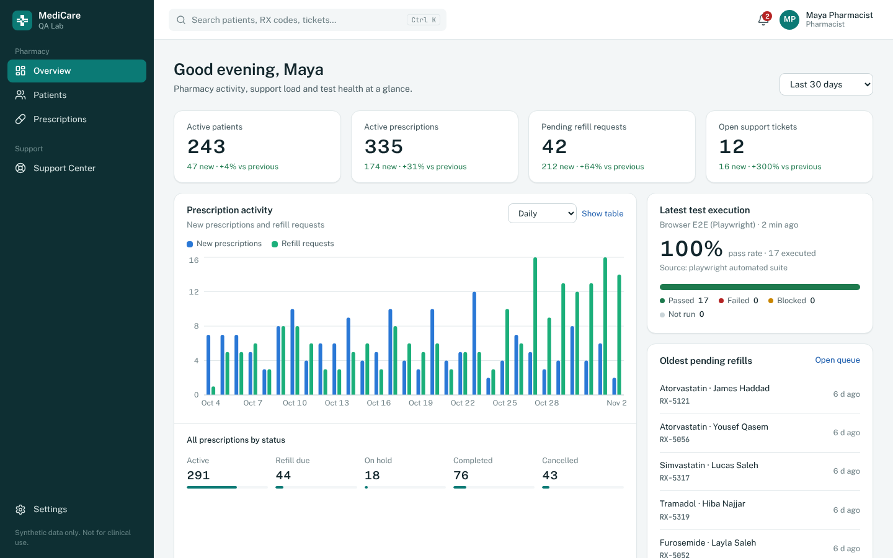

## What it demonstrates

| Area | In the app |
|---|---|
| Manual testing | 30 documented test cases with steps and expected results. Test runs record Pass / Fail / Blocked / Not run with actual results. Failed results become bug reports. |
| Automated testing | 115 backend tests (pytest, real PostgreSQL), 17 Playwright browser tests, a Postman collection with 31 requests and 112 assertions. Real results are uploaded into the QA Lab. |
| Bug reporting | Five complete bug reports: four controlled defects plus one real bug that the E2E suite caught during development ([BUG-005](docs/bug-reports/BUG-005-login-rate-limiter.md)). |
| API troubleshooting | Request IDs on every response, a standard error envelope, request tracing, an in-app API console, an audit trail, and read-only database consistency checks. |
| Support workflow | Tickets with diagnostics, assignment, escalation, internal notes, resolution and history, plus one-click conversion of a ticket into an engineering bug. |
| Security and privacy | JWT auth, role-based access enforced by the API, masked patient contact details for non-pharmacist roles, and redacted logs and audit entries. |

## Screenshots

| | |
|---|---|
| 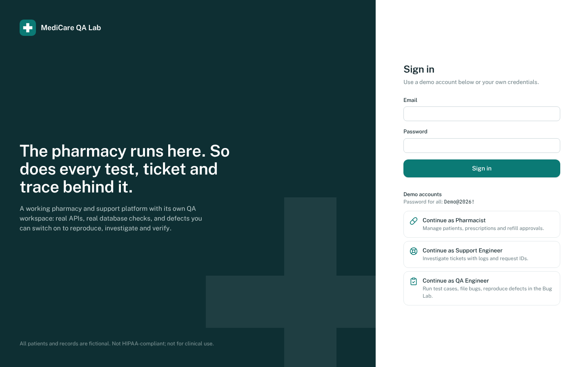 Sign in with one-click demo accounts | 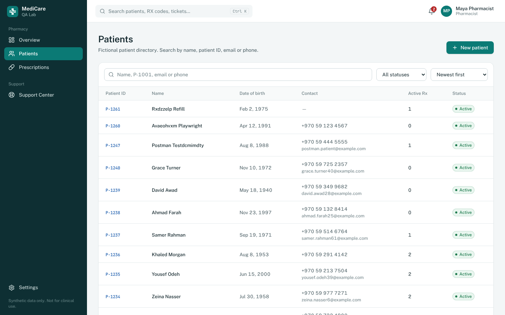 Patient directory with search and filters |
| 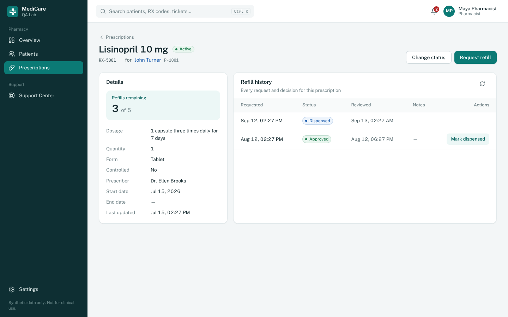 Prescription with refill history and approval | 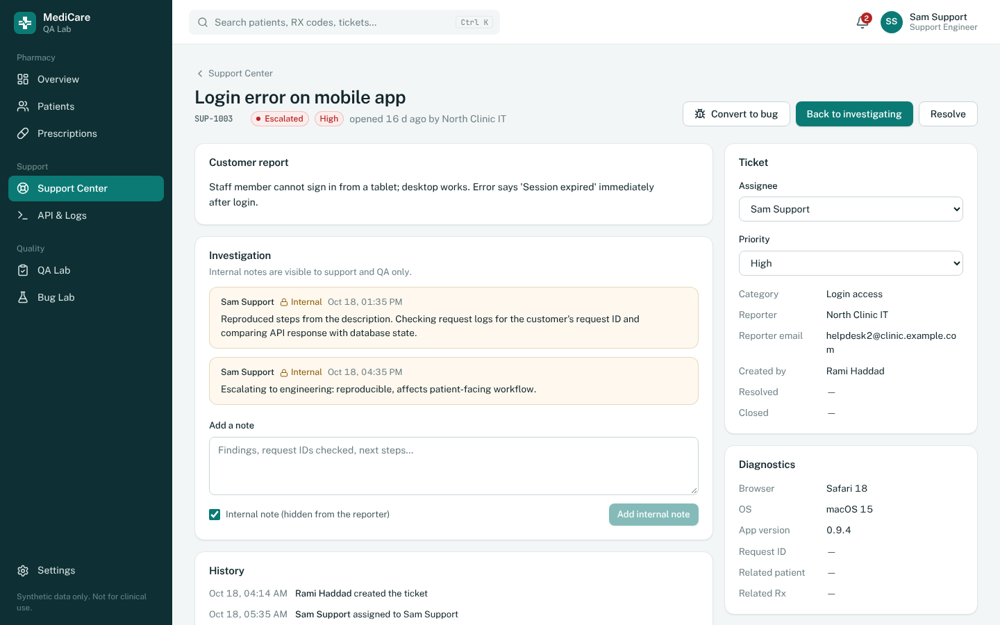 Ticket investigation with internal notes |
| 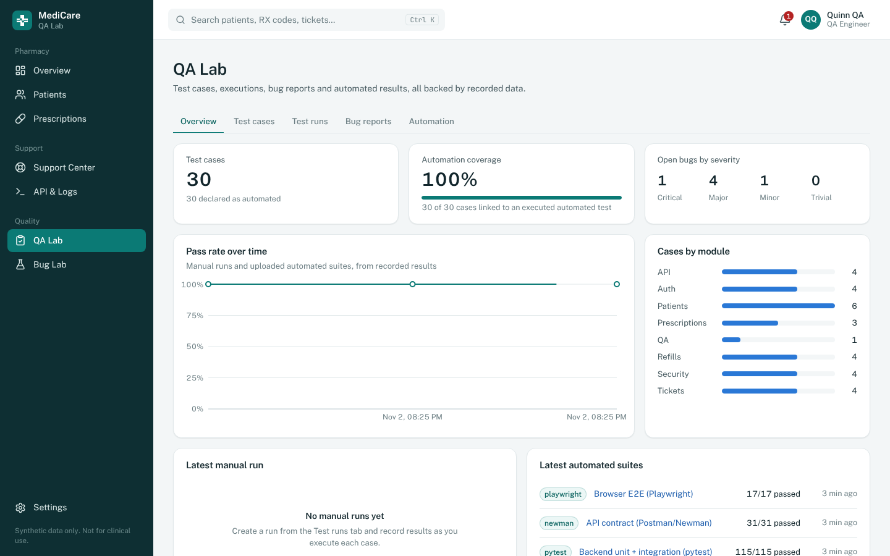 QA Lab metrics computed from recorded results | 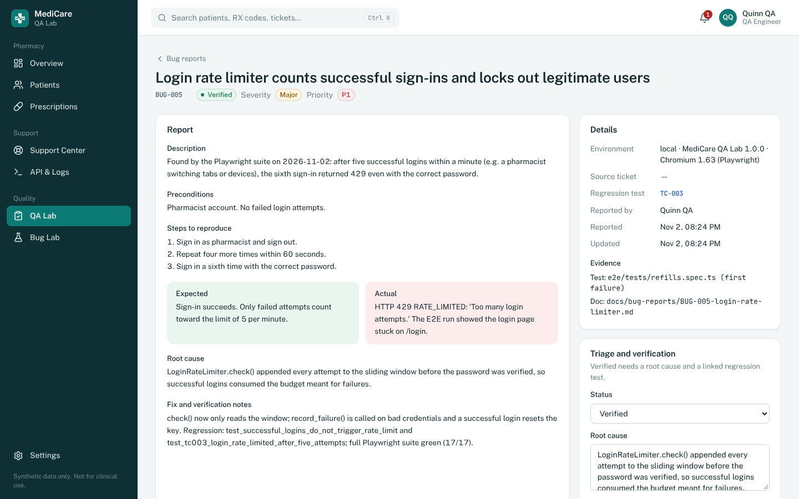 Bug report with root cause and regression link |
| 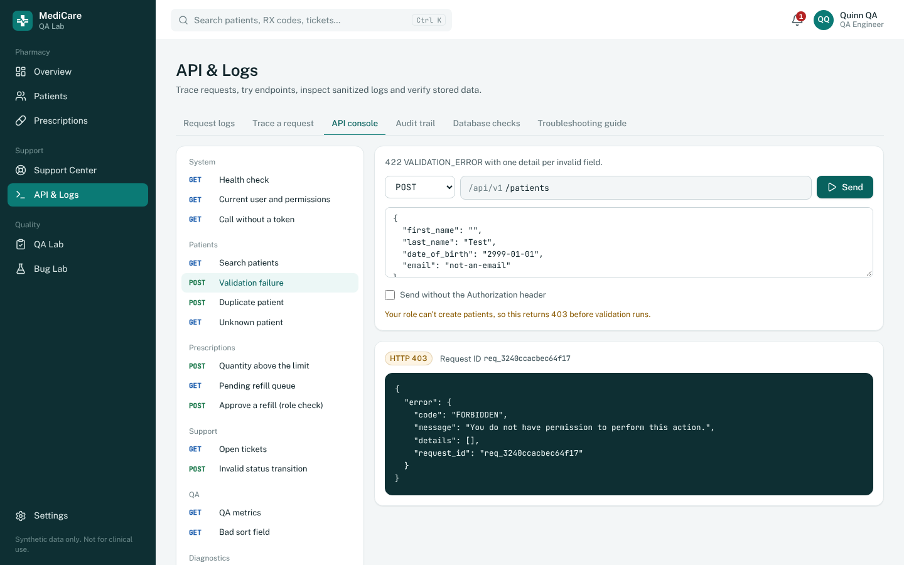 API console sending a real request (422 shown) | 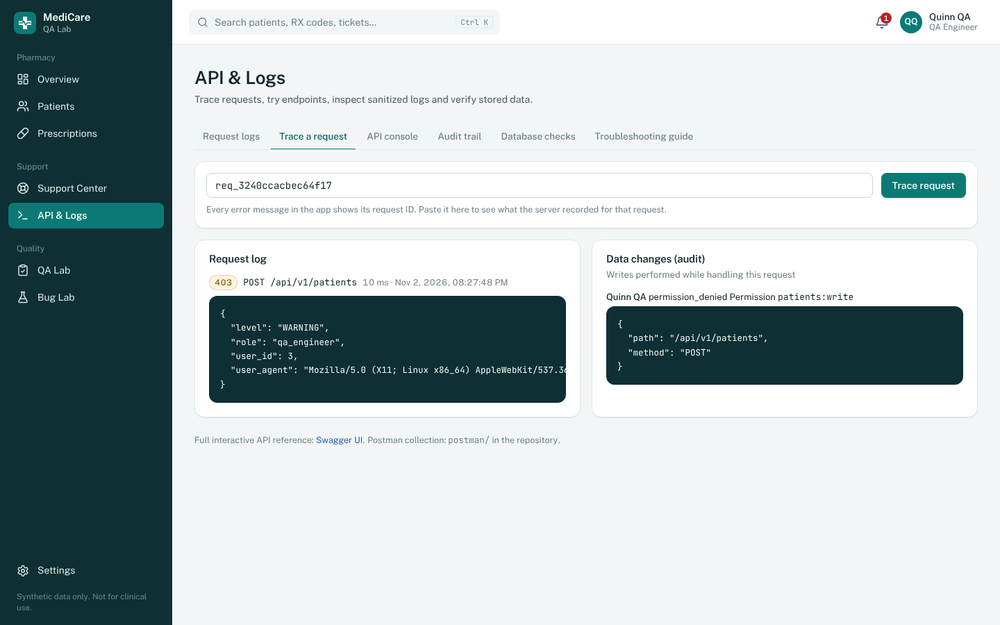 Tracing a request ID to its log and audit entries |
| 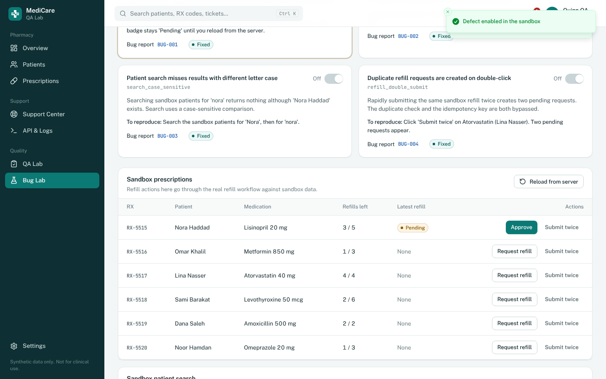 Bug Lab reproducing the stale refill status defect | 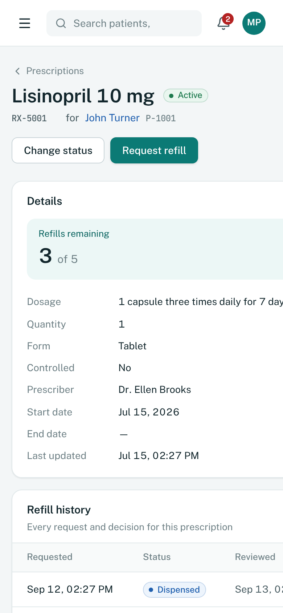 Responsive layout on a phone |

## Demo accounts

Password for all accounts: `Demo@2026!`

| Role | Email | Can |
|---|---|---|
| Pharmacist | `pharmacist@medicare.example.com` | Manage patients and prescriptions; submit, approve, reject and dispense refills |
| Support Engineer | `support@medicare.example.com` | Investigate and manage tickets, read logs and audit, convert tickets to bugs |
| QA Engineer | `qa@medicare.example.com` | Write test cases, run tests, manage bugs, control the Bug Lab, read logs |

The full permission table is in [docs/api.md](docs/api.md#role-based-access-matrix).

## Architecture

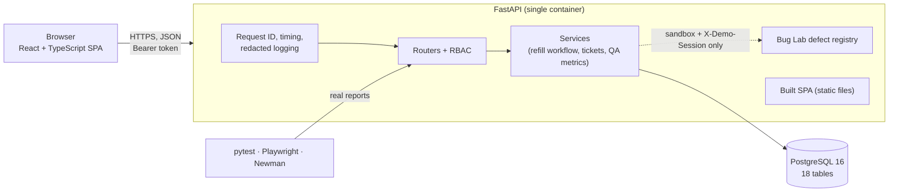

One image serves the API under `/api` and the frontend for every other path. Design decisions and trade-offs are in [docs/architecture.md](docs/architecture.md).

| Layer | Technology |
|---|---|
| Frontend | React 19, TypeScript, Tailwind CSS 4, Radix-based components in shadcn/ui style, TanStack Query, Recharts |
| Backend | Python 3.13, FastAPI, SQLAlchemy 2, Alembic, Pydantic 2, PyJWT, bcrypt |
| Database | PostgreSQL 16 |
| Testing | pytest, Playwright, Postman / Newman |
| Delivery | Docker, Docker Compose, Render blueprint, GitHub |

## Run locally

### Option A: Docker Compose

```bash
git clone https://github.com/SaraEwaida/medicare-qa-lab.git
cd medicare-qa-lab
docker compose up --build
```

Open http://localhost:8000. Migrations and synthetic seed data run automatically on startup.

### Option B: without Docker

Requirements: Python 3.12+, Node 20+, PostgreSQL 16.

```bash
# 1. Databases
createuser -P medicare            # password: medicare
createdb -O medicare medicare
createdb -O medicare medicare_test

# 2. Backend
cd backend
python3 -m venv .venv && source .venv/bin/activate
pip install -r requirements-dev.txt
alembic upgrade head
python -m app.db.seed             # add --reset to start over
uvicorn app.main:app --reload     # API on http://localhost:8000

# 3. Frontend (second terminal)
cd frontend
npm install
npm run dev                       # app on http://localhost:5173 (proxies /api to :8000)
```

To serve the built frontend from FastAPI like production: `npm run build`, then start uvicorn with `FRONTEND_DIST=../frontend/dist`. Settings are listed in [.env.example](.env.example).

## API documentation

- Swagger UI: http://localhost:8000/api/docs. Click **Authorize** and paste the `access_token` from `POST /api/v1/auth/login`.
- ReDoc: http://localhost:8000/api/redoc
- Endpoint list, error codes and role matrix: [docs/api.md](docs/api.md)

Every response has an `X-Request-ID` header. Errors use one envelope:

```json
{ "error": { "code": "REFILL_DUPLICATE", "message": "A pending refill request already exists for RX-5012.",
             "details": [], "request_id": "req_7b1f0c9a2d4e6f81" } }
```

## Database

18 tables: users, patients, medications, prescriptions, refill requests, support tickets, notes, events, test cases, steps, runs, results, bug reports, automation runs and results, Bug Lab flags, request logs and audit logs. Business rules are enforced in the database as well as the API: partial unique indexes stop duplicate patients, duplicate active prescriptions and a second pending refill, and CHECK constraints guard refill counters and status rules. See [docs/database.md](docs/database.md) for the diagram.

Verify stored data with SQL, for example:

```sql
-- refill counters must match approved/dispensed refills (also available in API & Logs → Database checks)
SELECT p.rx_code, p.refills_authorized, p.refills_remaining, count(r.id) AS used
FROM prescriptions p
LEFT JOIN refill_requests r ON r.prescription_id = p.id AND r.status IN ('approved', 'dispensed')
GROUP BY p.id HAVING p.refills_remaining <> p.refills_authorized - count(r.id);
```

## Testing

```bash
# Backend: unit + integration against the medicare_test database
cd backend && pytest

# API contract: Postman collection via Newman (app must be running)
cd postman && npx newman run MediCare-QA-Lab.postman_collection.json -e local.postman_environment.json

# Browser E2E (app must be running on :8000)
cd e2e && npm install && npx playwright test

# Everything, with results uploaded to the QA Lab and saved for deployment
./scripts/run_all_tests.sh
```

Test names carry their manual case code (`test_tc017_…`, `[TC-017]`). The upload script uses these codes to link automated results to manual cases, which is how the QA Lab computes coverage.

| Document | Content |
|---|---|
| [Manual test cases](docs/test-cases/manual-test-cases.md) | TC-001 to TC-030 with preconditions, steps and expected results |
| [Test execution report](docs/test-cases/test-execution-report.md) | Latest real results: 115/115 pytest, 31/31 Newman, 17/17 Playwright |
| [Bug reports](docs/bug-reports/README.md) | BUG-001 to BUG-005 with evidence, root cause and verification |

## Bug Lab (controlled defects)

The Bug Lab is a separate, clearly labelled sandbox with four switchable defects:

| Defect | Symptom |
|---|---|
| `refill_status_stale` | Approve returns 200, but the response still says "pending" |
| `refill_boundary_422` | A refill with exactly 1 remaining is rejected (off-by-one) |
| `search_case_sensitive` | Searching "nora" misses "Nora Haddad" |
| `refill_double_submit` | A double-click creates two pending refills |

A defect only fires when **all** of these are true: the environment switch is on, the defect is enabled, the request comes from the Bug Lab (`X-Demo-Session` header), and the data is sandbox data. Normal application paths can't reach an injected defect; integration tests prove this (`test_demo_isolation.py`).

The workflow is: reproduce, investigate in API & Logs, document (each defect has a bug report), fix (switch the defect off), and verify with the linked regression test case.

## Support troubleshooting

The [Level 1 support guide](docs/support-guide.md) covers triage, how to investigate with request IDs, logs, audit and database checks, when to convert a ticket into a bug, severity versus priority, a worked example, and customer reply templates.

## Deployment

A free public link via Render and Neon is described in [docs/deployment.md](docs/deployment.md). The `render.yaml` blueprint deploys the Docker image and redeploys on every push to `main`.

## Security and privacy

- Authentication uses JWT bearer tokens (60 minutes) and bcrypt password hashes. Failed logins are rate-limited (5 per minute per IP and email).
- Roles are enforced on every API endpoint. The UI only hides what a role can't use, and denied attempts are recorded in the audit trail.
- Non-pharmacist roles see masked patient contact details (email, phone), and date of birth, address and allergies are hidden from them.
- Request logs and audit entries are redacted before storage: names, emails, phone numbers, addresses, search terms, tokens and diagnostic notes are masked.

### Known limitations

- Not HIPAA-compliant and not audited; synthetic data only.
- The token is stored in `sessionStorage`, which is exposed to XSS in a way an httpOnly cookie wouldn't be. This is acceptable for a demo and documented in the architecture decisions.
- The login rate limiter is in-memory and per instance. Scaling out would need a shared store such as Redis.
- Demo accounts are shared, so anyone using a public deployment can change its data. Reset it with `python -m app.db.seed --reset`.
- The Docker image couldn't be built in the development sandbox because container registries were blocked there. Its steps (frontend build, dependency install, migrations, seed, server start) were verified individually on a fresh database.

## Project structure

```
backend/    FastAPI app, Alembic migrations, seed data, pytest suites
frontend/   React + TypeScript app
e2e/        Playwright tests
postman/    Postman collection, environment and generator
scripts/    run_all_tests.sh, upload_test_report.py, generate_test_docs.py
docs/       architecture, database, API, support guide, deployment, test cases, bug reports, screenshots
```
