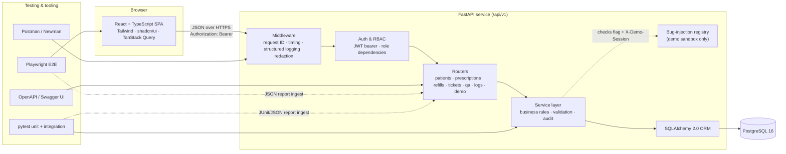

# MediCare QA Lab — Architecture (Phase 1)

> Synthetic data only. This project is a demonstration and is **not** HIPAA-compliant or independently audited.

## 1. System overview



Three containers in Docker Compose: `frontend` (Vite build served by nginx, which also reverse-proxies `/api`), `backend` (uvicorn), `db` (postgres:16). Same-origin through the proxy means no CORS complexity in production; CORS is enabled only for local dev.

## 2. Key architectural decisions

| # | Decision | Why | Trade-off |
|---|---|---|---|
| D1 | **Monorepo** (`backend/`, `frontend/`, `e2e/`, `postman/`, `docs/`) | One clone, one `docker compose up`, easy for interviewers to review | Less separation than multi-repo; fine for this scale |
| D2 | **FastAPI + SQLAlchemy 2.0 + Alembic + Pydantic v2** | Auto-generated OpenAPI/Swagger, typed validation that produces precise 422 errors (great QA material), versioned migrations | Sync SQLAlchemy chosen over async for simpler tests and debugging |
| D3 | **JWT bearer auth** (60-min access token, bcrypt passwords) | Works identically from the SPA, Swagger "Authorize" and Postman — important for API-testing demos | Token kept in `sessionStorage` (cleared on tab close). An httpOnly cookie would be stronger against XSS; documented as a known limitation |
| D4 | **RBAC enforced server-side** via a `require_permission("patients:write")` dependency; frontend hides UI per role but never relies on it | Authorization must be testable at the API level (403 test cases) | Permission map lives in code, not DB — simpler, reviewed via PRs |
| D5 | **Request ID on every request** (`X-Request-ID` echoed or generated) and a **standard error envelope** | Lets support engineers trace a user-reported error to a log line — the core L1 support skill this project demonstrates | — |
| D6 | **Logs persisted to `app_logs`** (plus stdout JSON) with a redaction filter (names, phone, email, DOB, free-text diagnostic fields masked) | The API & Logs Explorer queries real logs, not fixtures | Logging to DB adds write load; acceptable for a demo, retention job trims to 14 days |
| D7 | **Audit log** on every create/update/delete/status change (`audit_logs`: who, what, before/after diff with redaction) | Healthcare apps need traceability; also used for "database verification" examples | — |
| D8 | **Controlled bug injection isolated three ways**: (1) `DEMO_BUGS_ENABLED` env var, (2) per-bug flag in `demo_bug_flags`, (3) bug only fires when the request carries `X-Demo-Session` *and* targets sandbox rows (`is_sandbox = true`) | Normal app paths can never hit an injected defect, even if a flag is left on | A little extra branching in a few service functions, kept in one `demo/` module |
| D9 | **QA metrics are computed, never hardcoded**: pass rate, coverage etc. come from `test_run_results` and ingested automation reports (`automation_runs`) | Project rule: no fake success metrics | Dashboard shows empty states until tests are actually executed |
| D10 | **Frontend: Vite + React Router + TanStack Query + react-hook-form + zod + Recharts** | Query cache makes loading/error/empty states consistent; zod mirrors backend validation for instant feedback | Validation rules duplicated client/server; server remains the source of truth |
| D11 | **Business identifiers separate from PKs**: `P-1024`, `RX-5781`, `SUP-1042`, `TC-001`, `BUG-007` | Human-readable IDs for tickets/bug reports; integer PKs stay internal | Generated via Postgres sequences + prefix |

**Roles:** the brief defines three roles (Pharmacist, Support Engineer, QA Engineer). The reference image also mentions Admin; I'm leaving it out to keep the scope tight. Settings that would need an admin (demo-bug toggles, user list) go to QA Engineer.

## 3. Folder structure

```
medicare-qa-lab/
├── backend/
│   ├── app/
│   │   ├── main.py               # app factory, middleware, router registration
│   │   ├── core/                 # config, security (JWT, hashing), permissions, logging, redaction
│   │   ├── db/                   # engine, session, base, seed
│   │   ├── models/               # SQLAlchemy models (one file per aggregate)
│   │   ├── schemas/              # Pydantic request/response models
│   │   ├── services/             # business logic (refill workflow, ticket escalation, metrics)
│   │   ├── api/v1/               # routers: auth, patients, prescriptions, refills, tickets, qa, logs, dashboard, demo
│   │   └── demo/                 # bug-injection registry (isolated)
│   ├── alembic/                  # migrations
│   ├── tests/
│   │   ├── unit/
│   │   └── integration/          # real Postgres via test database
│   ├── pyproject.toml
│   └── Dockerfile
├── frontend/
│   ├── src/
│   │   ├── app/                  # router, providers, auth context
│   │   ├── components/ui/        # shadcn/ui primitives
│   │   ├── components/           # shared: DataTable, StatusBadge, PageHeader, EmptyState, ErrorState
│   │   ├── features/             # dashboard, patients, prescriptions, tickets, qa, api-logs, bug-lab, settings
│   │   ├── lib/                  # api client (request-ID aware), zod schemas, formatters
│   │   └── main.tsx
│   ├── Dockerfile                # build + nginx
│   └── nginx.conf
├── e2e/                          # Playwright tests + config
├── postman/                      # collection + environment JSON
├── docs/
│   ├── architecture.md           # this file
│   ├── database.md
│   ├── api.md
│   ├── roadmap.md
│   ├── schema.sql                # validated DDL draft (Alembic becomes source of truth in Phase 3)
│   ├── test-cases/               # manual test cases (Phase 4)
│   ├── bug-reports/              # documented defects (Phase 5)
│   └── support-guide.md          # troubleshooting playbook (Phase 5)
├── docker-compose.yml
├── .env.example
└── README.md
```

## 4. Critical user journeys

These drive both the build order and the test plan. Each will get manual test cases and at least the starred ones get Playwright coverage.

| ID | Role | Journey | Key checks |
|---|---|---|---|
| J1 ★ | Any | Log in with demo account → land on role-appropriate dashboard → log out | Wrong password → 401 with generic message; locked nav items per role |
| J2 ★ | Pharmacist | Search patient → open profile → edit phone → save | Validation (phone format, required fields), audit entry written |
| J3 ★ | Pharmacist | Create prescription for patient → submit refill request → approve → status updates everywhere | Duplicate pending refill rejected (409); refills remaining decremented; status refreshes without reload |
| J4 ★ | Support Engineer | Create ticket (category, priority, diagnostics) → investigate → add internal note → escalate → resolve → close | Valid status transitions only; internal notes hidden from non-support roles; history recorded |
| J5 | Support Engineer | Look up a user's request ID in Logs Explorer → find the failing request → link to ticket | Logs redacted; filter by request ID, status code, path |
| J6 ★ | QA Engineer | Create test case → start test run → record Pass/Fail/Blocked → file bug from failure | Run metrics recompute; bug linked to failed result |
| J7 | Support → QA | Convert support ticket into engineering bug report | Bug pre-filled from ticket; bidirectional link |
| J8 | QA Engineer | Bug Lab: enable a defect → reproduce in sandbox → inspect logs → disable → regression test passes | Defect never affects non-sandbox data or requests without `X-Demo-Session` |
| J9 | Any | Unauthorized action (e.g. Support Engineer approving a refill via API) | 403 with request ID; attempt logged |

## 5. Cross-cutting conventions

- **Error envelope** (all non-2xx):
  ```json
  {"error": {"code": "REFILL_DUPLICATE", "message": "A pending refill request already exists for RX-5781.",
             "details": [], "request_id": "req_01J…"}}
  ```
- **Pagination:** `?page=1&page_size=20` (max 100) → `{"items": [...], "total": 248, "page": 1, "page_size": 20}`.
- **Timestamps:** UTC ISO-8601 in API, rendered in the user's local zone in the UI.
- **Optimistic concurrency:** `updated_at` sent back on edits; stale writes → 409.
- **Redaction:** a single `redact()` utility used by both log and audit writers; covered by unit tests.
