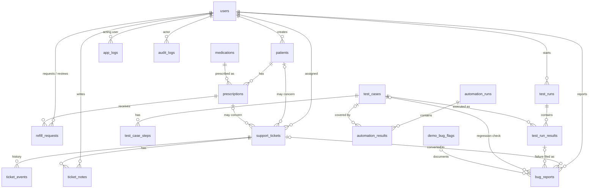

# Database design

PostgreSQL 16. 18 tables in 5 groups. The full DDL is in [`schema.sql`](schema.sql). Constraint checks are in [`schema-checks.sql`](schema-checks.sql) (validated against PostgreSQL 16: all 12 negative cases rejected as intended).

## Entity relationships

## Groups

| Group | Tables | Notes |
|---|---|---|
| Identity | `users` | Role enum: pharmacist, support_engineer, qa_engineer. bcrypt hashes only. |
| Pharmacy | `patients`, `medications`, `prescriptions`, `refill_requests` | `ON DELETE RESTRICT` where history matters. Patients are deactivated, never hard-deleted. |
| Support | `support_tickets`, `ticket_notes`, `ticket_events` | Diagnostic fields on the ticket; `related_request_id` links to `app_logs`. |
| QA | `test_cases`, `test_case_steps`, `test_runs`, `test_run_results`, `bug_reports`, `automation_runs`, `automation_results` | Metrics are computed from these tables, never stored as totals. |
| Platform | `demo_bug_flags`, `app_logs`, `audit_logs` | Logs are redacted before insert. |

## Integrity rules enforced in the database

Defense in depth: the API validates first and returns friendly errors, and the database still enforces the rules if the API has a bug.

| Rule | Mechanism |
|---|---|
| No duplicate real patient (same name + DOB, case-insensitive) | Partial unique index `uq_patient_identity` |
| One active prescription per patient + medication | Partial unique index `uq_active_rx_per_med` |
| One pending refill per prescription | Partial unique index `uq_one_pending_refill` |
| Double-submit protection | `refill_requests.idempotency_key UNIQUE` |
| `0 ≤ refills_remaining ≤ refills_authorized` | CHECK |
| Rejected refill needs a reason; pending ⇔ not yet reviewed | CHECK |
| Resolved/closed ticket needs a resolution | CHECK |
| Failed test result needs an actual result | CHECK |
| Verified/closed bug needs a root cause | CHECK |
| Automation totals add up | CHECK `passed + failed + skipped = total` |
| DOB in the past; phone format | CHECK |

Partial indexes exclude `is_sandbox = true` rows. That lets the Bug Lab reproduce "duplicate request" defects on sandbox data while real data stays protected.

## Business identifiers

Generated from sequences: `P-1001`, `RX-5001`, `SUP-1001`, `TC-001`, `BUG-001`. Gaps after a rolled-back insert are expected Postgres behavior and not a defect. This is a useful QA talking point.

## Notes for Phase 3 (Alembic)

- Name every CHECK constraint explicitly (e.g. `ck_refill_rejection_reason`) so the API can map a DB `IntegrityError` to a specific error code.
- Add `updated_at` triggers or ORM `onupdate` handling.
- Add a scheduled `app_logs` retention delete (14 days).
